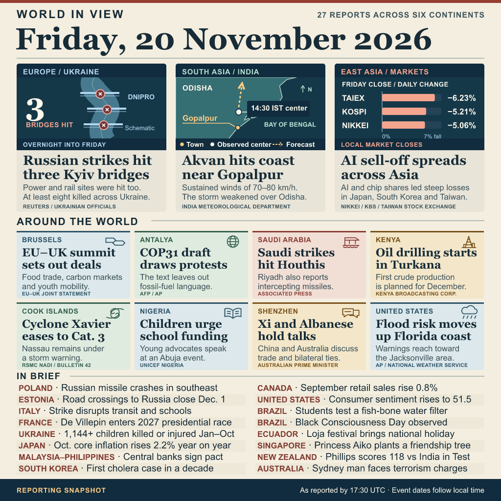

# World in View

[](https://make.fun/bounty/news-image-20261120)
[](https://make.fun/bounty/news-image-20261120/leaderboard)
[](https://make.fun/bounty/news-image-20261120)

An illustrated snapshot of Friday, 20 November 2026, with 27 reports across six continents. It leads with the strikes in Ukraine, Cyclone Akvan's landfall in India, and the Asia-wide equity sell-off. The reporting cutoff is 17:30 UTC. Each event or material update is dated in its local time.



## Run it

```sh
MAKEFUN_OUTPUT_DIR=./out node main.ts
```

Node 22 writes the checked-in edition to `entry.png` using the standard library. The contest run requires no network or font dependencies. To recreate the artwork, install `@resvg/resvg-js` and use `node render.mjs <file-URL-of-resvg-js/index.js> front-page.png` with Arial and Georgia installed.

## Reporting ledger

| Report | What Friday brought | Evidence |
| --- | --- | --- |
| Kyiv | Russian attacks overnight into Friday hit three Kyiv bridges over the Dnipro and damaged electricity and rail infrastructure. Officials reported six deaths in Kyiv and two in Lviv. The figure on the page is nationwide. | [Reuters](https://www.investing.com/news/commodities-news/eight-killed-in-ukraine-as-russia-hits-back-after-crimea-bridge-attacks-5041652) |
| Akvan | Landfall near Gopalpur between 07:30 and 08:30 IST with 70–80 km/h sustained winds. The map shows the observed inland center at 14:30 IST, at 20.0°N, 84.9°E. | [IMD landfall release](https://internal.imd.gov.in/press_release/20261120_pr_5512.pdf), [IMD Bulletin 40](https://mausam.imd.gov.in/backend/assets/cyclone_pdf/40__National_Bulletin_No_40-20Nov2026_1430IST_docx.pdf) |
| Asia equities | Friday's local closing changes were TAIEX −6.23%, KOSPI −5.21% and Nikkei 225 −5.06%. | [Taiwan Stock Exchange](https://www.twse.com.tw/exchangeReport/MI_INDEX?date=20261120&response=html&type=ALLBUT0999), [KBS](https://rki.kbs.co.kr/service/news_view.htm?Seq_Code=205717&lang=e), [Nikkei](https://indexes.nikkei.co.jp/nkave/archives/summary?dt=20261120&idx=nk225) |
| Brussels | The EU–UK summit statement sets out steps on food trade, emissions trading and youth mobility. Further implementation remains ahead. | [EU–UK joint statement](https://assets.publishing.service.gov.uk/media/6b003dbde43662b58d107613/EU-UK_Summit_Joint_Statement_2026.docx.pdf) |
| Antalya | Delegates and campaigners reacted on Friday to a COP31 draft that omitted fossil-fuel language. The visual describes the contested draft stage. | [AFP](https://www.afp.com/en/cop31-deal-elusive-fossil-fuel-fight-deepens), [AP](https://apnews.com/article/a683c5c87a7ee64caf4e9257948b6e40) |
| Saudi Arabia and Yemen | AP reported Saudi strikes on Houthi targets and Saudi claims that it intercepted missiles. | [AP](https://apnews.com/article/16c39c487a23b53b73c5eabb7f0fd57a) |
| Kenya | Gulf Energy began drilling in South Lokichar, Turkana. The December start date refers to planned oil production. | [Kenya Broadcasting Corporation](https://www.kbc.co.ke/kenya-begins-commercial-crude-oil-drilling-in-south-lokichar/) |
| Cook Islands | RSMC Nadi reported Xavier at Category 3 and a continuing storm warning for Nassau. See Special Advisory 42, issued 20 November at 11:26 UTC. | [Fiji Meteorological Service warnings](https://www.met.gov.fj/warnings/) |
| Nigeria | Children advocated for investment in survival and learning at the World Children's Day event in Abuja. | [UNICEF Nigeria](https://www.unicef.org/nigeria/press-releases/nigerian-children-call-all-stakeholders-make-their-survival-learning-and-future-a-shared-responsibility) |
| China and Australia | Xi Jinping and Anthony Albanese met in Shenzhen on Friday and discussed bilateral and economic ties. | [Australian prime minister's press conference](https://www.pm.gov.au/media/press-conference-shenzhen-china-20-november-2026), [Chinese foreign ministry](https://www.mfa.gov.cn/mfa_eng./xw/zyxw/202611/t20261120_12063986.html) |
| Florida | Flood warnings and watches extended north along the Atlantic coast toward Jacksonville. | [AP citing the National Weather Service](https://apnews.com/article/46b14622b3ad77c32eb0182bfe8bc9f4) |
| Poland | A Russian cruise missile crashed in southeastern Poland during the overnight attack. | [AP](https://apnews.com/article/63386266cef90907913df2b456808a4d) |
| Estonia | Estonia announced that road border crossings with Russia would close from 1 December. | [Estonian foreign ministry](https://www.vm.ee/en/news/foreign-minister-tsahkna-border-closure-russias-hostile-activities-against-estonia-and-europe) |
| Italy | A nationwide strike affected transport and schools. | [AP](https://apnews.com/article/8a742daa7242c84d99307c1fcc864f62) |
| France | Dominique de Villepin declared his candidacy for the 2027 presidential election. | [AP](https://apnews.com/article/abd1b09867e78f646245f3202821ca35) |
| Ukraine / children | UNICEF reported at least 1,144 verified child deaths and injuries between January and October 2026. The count is for the ten-month period, separate from the overnight attack in the lead. | [UNICEF](https://www.unicef.org/press-releases/child-casualties-ukraine-reach-highest-level-almost-four-years-unicef) |
| Japan | The October CPI release put prices excluding fresh food up 2.2% year on year. All-items inflation was 2.3%. | [Statistics Bureau of Japan, October PDF](https://www.e-stat.go.jp/stat-search/file-download?fileKind=2&statInfId=000040525997) |
| Malaysia and Philippines | Their central banks signed a cooperation memorandum on Friday. | [Bank Negara Malaysia](https://www.bnm.gov.my/-/mou-bspbnm-1126) |
| New Zealand | Glenn Phillips scored 118 on day two of the first Test against India at Wellington. | [ICC](https://www.icc-cricket.com/tournaments/world-test-championship/news/historic-first-for-new-zealand-batter-following-india-century), [AFP](https://www.afp.com/en/nicholls-unbeaten-175-new-zealand-make-368-against-india) |
| South Korea | South Korean authorities reported the country's first confirmed cholera case in ten years. | [AP citing the KDCA](https://apnews.com/article/165b77a63c5cc3c48fc7c7b87186a7a6) |
| Canada | September retail sales rose 0.8% to C$75.3 billion, according to Friday's release. | [Statistics Canada](https://www150.statcan.gc.ca/n1/daily-quotidien/261120/dq261120a-eng.htm) |
| Brazil | Friday reports described an Amazon student project testing a prototype water filter made with fish bones. | [Reuters via Internazionale](https://www.internazionale.it/ultime-notizie-reuters/2026/11/20/brazilian-students-turn-to-burned-fish-bones-as-clean-water-filter), [CNN Brasil](https://www.cnnbrasil.com.br/ciencia/como-restos-de-ossos-de-pirarucu-aquecidos-a-900-oc-substituiram-o-carvao-e-transformaram-a-agua-do-solimoes-no-amazonas/) |
| Brazil / culture | Black Consciousness Day was observed on Friday. Public activities highlighted Afro-Brazilian culture, memory and education. | [Brazilian Ministry of Culture](https://www.gov.br/cultura/pt-br/assuntos/noticias/minc-celebra-o-dia-da-consciencia-negra-com-acoes-afirmativas-e-programacao-cultural), [Ceará government](https://www.ce.gov.br/2026/11/20/dia-da-consciencia-negra-marca-a-trajetoria-de-geracoes-pelo-direito-a-educacao-a-memoria-e-ao-respeito/) |
| Ecuador | A nationwide day off on Friday supported the arts festival taking place in Loja. | [Ecuadorian vice presidency](https://www.vicepresidencia.gob.ec/el-feriado-nacional-del-20-de-noviembre-se-mantiene-esmeraldas-y-loja-tendran-un-dia-adicional-de-descanso/), [Loja festival programme](https://festivaldeloja.com/wp-content/uploads/2026/11/PROGRAMA-DE-MANO-LOJA-2026-1-combined-1-compressed_compressed.pdf) |
| United States | Friday's final November consumer sentiment reading rose to 51.5 from 48.0 in October. | [University of Michigan](https://www.sca.isr.umich.edu/), [Axios](https://www.axios.com/2026/11/20/consumer-sentiment-midterms-energy) |
| Singapore | Princess Aiko planted a commemorative fukugi tree at Singapore's Japanese Garden on Friday during her official visit. | [Singapore foreign ministry](https://www.mfa.gov.sg/newsroom/press-statements-transcripts-and-photos/official-visit-by-her-imperial-highness-princess-aiko-of-japan-17-to-21-november-2026/), [The Japan Times](https://www.japantimes.co.jp/news/2026/11/20/japan/princess-aiko-tree-singapore/) |
| Australia | Police charged a man in Sydney with terrorism-related offences. The case concerns charges, with no finding of guilt. | [New South Wales Police](https://ebizprd.police.nsw.gov.au/media/129826.html), [AP](https://apnews.com/article/02f9088f02b09d5e0783b862ad64c0fa) |

## Reading the graphics

- The Kyiv illustration is a schematic count of the three bridges mentioned in the reporting. The red marks indicate reported strikes on the bridges.
- The Akvan map uses a gold dot for Gopalpur, a white dot for the observed storm center and a dashed arrow for the bulletin's forecast direction. The arrow stops within the map and does not mark a confirmed later position. The coastline is simplified from [Natural Earth](https://www.naturalearthdata.com/about/terms-of-use/).
- The Asian market bars share a zero baseline and a 7% maximum fall. Each label gives its index's signed close-to-close change.
